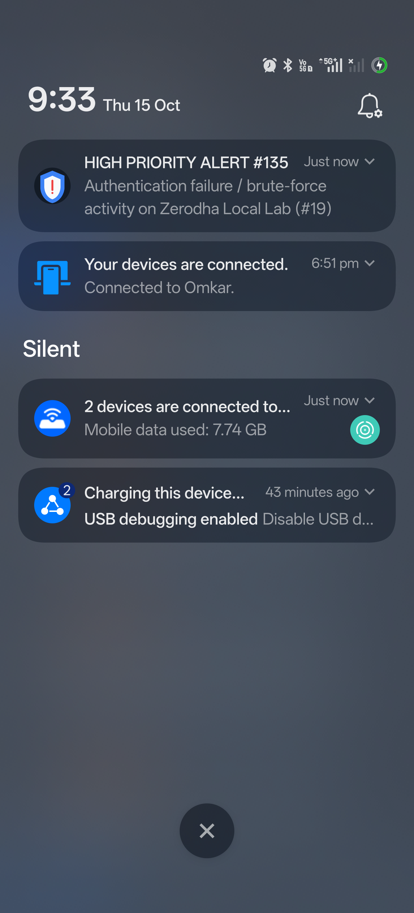
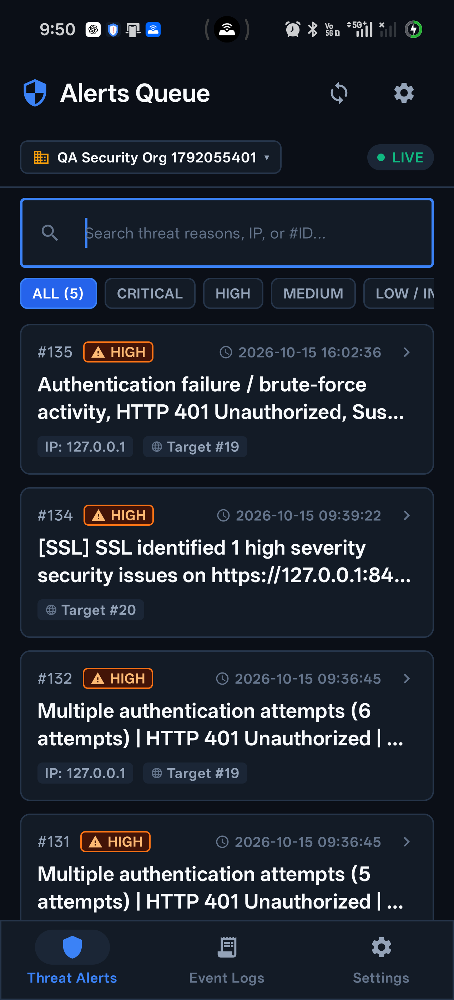
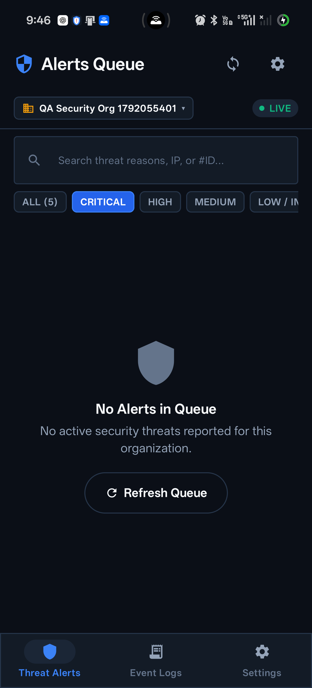
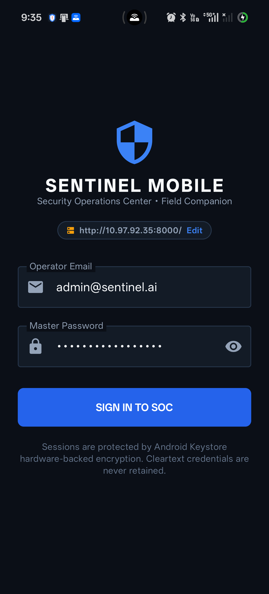

# Sentinel Mobile

[-3DDC84?style=flat&logo=android&logoColor=white)](https://developer.android.com)
[](https://kotlinlang.org)
[](https://developer.android.com/jetpack/compose)
[](https://square.github.io/retrofit/)
[](https://developer.android.com/training/articles/keystore)

**Sentinel Mobile** is the official lightweight companion application for the **Sentinel AI Threat Intelligence & Detection Platform**. It delivers real-time security alerts, push notifications, and quick triage capabilities directly to your Android device.

---

## 📌 Scope & Purpose

> [!IMPORTANT]
> **Sentinel Mobile is an alerting, notification, and triage companion app.**
> 
> Unlike the primary **Sentinel Core Web Platform** (which provides comprehensive SIEM ingestion pipelines, complex rule builders, automated vulnerability scanners, multi-tenant RBAC administration, and in-depth forensic packet capture analysis), **Sentinel Mobile is specifically focused on on-the-go awareness and rapid incident response**:
> - **Immediate Notification Delivery:** Ringing, chiming, and vibrating when `CRITICAL` or `HIGH` threats are detected.
> - **Alerts Queue & Triage:** Viewing, filtering, and investigating incoming security alerts from monitored web applications and endpoints.
> - **Live Telemetry Stream:** Inspecting recent HTTP security events and status codes.
> - **Context Switching:** Toggling between organization workspaces without leaving the mobile interface.

---

## 📱 Visual Tour

| Notification Banner | Alerts Queue | Threat Details | Event Logs |
| :---: | :---: | :---: | :---: |
|  |  |  |  |
| *Audible system alerts on real devices* | *Real-time queue with severity chips* | *Full forensic metadata & target IDs* | *Live HTTP telemetry inspection* |

---

## ✨ Features

- **🔔 High-Priority Sound & Push Notifications:**
  - Configured with dedicated Android Notification Channels (`sentinel_channel_critical`, `sentinel_channel_high`).
  - Triggers audible alarm ringtones, vibration patterns, and lock-screen heads-up banners on physical hardware.
  - Automatically raises alerts when new high-severity incidents arrive in the telemetry stream.

- **🛡️ Real-Time Alerts Queue:**
  - Live polling and background synchronization with the Sentinel backend.
  - Severity-based filtering: `ALL`, `CRITICAL`, `HIGH`, `MEDIUM`, and `LOW / INFO`.
  - In-memory deduplication and sorting by incident timestamp.

- **🔍 Detailed Alert Inspection:**
  - Inspect attack vectors, threat reasoning, and MITRE-style classifications.
  - View targeted assets (Target ID and asset name, e.g., *Zerodha Local Lab*).
  - Displays attacker/source IP addresses and remediation advice.

- **📜 Security Event Logs Stream:**
  - Live inspection of ingested HTTP requests.
  - Color-coded HTTP status badges (`200 OK`, `401 Unauthorized`, `403 Forbidden`, `500 Error`).
  - Search telemetry logs by path, method, IP, or user-agent.

- **🏢 Multi-Tenant Switching:**
  - Instant organization switcher for SOC analysts managing multiple tenants.
  - Strict tenant isolation ensures alerts and telemetry are filtered exclusively to the selected workspace.

- **🔐 Enterprise Mobile Security:**
  - **No Plaintext Passwords:** User tokens and refresh tokens are encrypted at rest using Android Keystore-backed `EncryptedSharedPreferences` (AES-256 GCM).
  - **Network Sanitization:** OkHttp logging interceptor redacts `Authorization`, `Cookie`, `X-Organization-ID`, and password fields.
  - **Dynamic Endpoint Configuration:** Switch seamlessly between local development, staging, and production Sentinel instances.

---

## 🏗️ Architecture & Technology Stack

The project adheres to Google's recommended **Clean Architecture** with a unidirectional data flow (UDF) powered by Jetpack Compose and Kotlin Coroutines/Flow:

```
app/src/main/java/ai/sentinel/mobile/
├── data/
│   ├── local/          # EncryptedSessionManager (AndroidX Keystore)
│   ├── model/          # Kotlinx.serialization DTOs (AlertDto, LogDto, TenantDto)
│   ├── remote/         # Retrofit API interface, Auth & DynamicBaseUrl Interceptors
│   └── repository/     # AuthRepository, AlertsRepository, LogsRepository, DeviceRepository
├── service/
│   ├── NotificationHelper.kt         # Android NotificationManager & Audio Channels
│   ├── SentinelFirebaseMessaging.kt # FCM background message handler
│   └── TestAlertBroadcastReceiver.kt # Broadcast receiver for testing alerts
├── ui/
│   ├── components/     # AlertCard, LogCard, TenantSelector, FilterChips
│   ├── navigation/     # Jetpack Navigation Compose graph & bottom navigation
│   ├── screens/
│   │   ├── auth/       # LoginScreen & LoginViewModel
│   │   ├── alerts/     # AlertsScreen, AlertsViewModel & AlertDetailSheet
│   │   ├── logs/       # LogsScreen, LogsViewModel & LogDetailSheet
│   │   └── settings/   # SettingsScreen & ServerUrlDialog
│   └── theme/          # Sentinel Cyber Dark Palette, Typography, Shapes
├── MainActivity.kt     # Single Activity Compose entry point
└── SentinelApplication.kt # Application container & dependency initialization
```

### Dependencies

| Technology | Purpose |
| :--- | :--- |
| **Kotlin 2.0.20** | Modern, type-safe programming language |
| **Jetpack Compose + Material 3** | Declarative Cyber Dark SOC UI |
| **Retrofit 2.11 + OkHttp 4.12** | Resilient REST networking with interceptors |
| **Kotlinx Serialization 1.7.3** | High-performance JSON parsing |
| **AndroidX Security Crypto** | Hardware-backed keystore session encryption |
| **Kotlin Coroutines & StateFlow** | Reactive state management |
| **Firebase Cloud Messaging** | Enterprise mobile push notification support |

---

## 🚀 Getting Started

### Prerequisites

1. **Android Studio** Ladybug (2024.2.1+) or newer.
2. **Java Development Kit (JDK):** JDK 17.
3. **Android SDK:** API 26 (Android 8.0 Oreo) minimum, compiled against API 35 (Android 15).
4. **Android Device or Emulator:**
   - Physical device with USB Debugging enabled, **or**
   - Android Virtual Device (AVD) running Android 8.0+.

---

### Environment Setup (`.env`)

1. Copy the environment configuration template:
   ```bash
   cp .env.example .env
   ```

2. Adjust the variables in `.env` to match your development environment:
   ```env
   # Sentinel Backend Endpoint
   SENTINEL_BASE_URL=http://127.0.0.1:8000/
   SENTINEL_BACKEND_PATH=../backend

   # Telemetry & Target Asset Configuration
   ZERODHA_URL=http://127.0.0.1:8080
   SENTINEL_URL=http://127.0.0.1:8000
   SENTINEL_API_KEY=your_sentinel_collector_api_key_here
   ORGANIZATION_ID=18
   WEBSITE_ID=19
   ```

> [!NOTE]
> `.env` and `local.properties` are included in `.gitignore` and are never committed to version control.

---

### Connecting to the Sentinel Backend

Depending on where your Sentinel backend is running, set the connection endpoint:

#### 1. Physical Device via USB (Recommended for real sound tests)
Run ADB reverse port forwarding so your phone can reach your laptop's `localhost`:
```bash
adb reverse tcp:8000 tcp:8000
adb reverse tcp:8080 tcp:8080
```
In the app's login or settings dialog, set the server URL to:
```
http://127.0.0.1:8000/
```

#### 2. Android Virtual Device (AVD Emulator)
The Android emulator accesses host machine loopback at:
```
http://10.0.2.2:8000/
```

#### 3. Local Wi-Fi / LAN
If testing wirelessly on the same network, use your computer's local IP:
```
http://192.168.1.XX:8000/
```

---

## 🛠️ Building & Running

### Using Gradle CLI

* **Build Debug APK:**
  ```bash
  ./gradlew assembleDebug
  ```
  *Output:* `app/build/outputs/apk/debug/app-debug.apk`

* **Install to connected device:**
  ```bash
  ./gradlew installDebug
  ```

* **Run Unit Tests:**
  ```bash
  ./gradlew test
  ```

* **Build Optimized Release APK:**
  ```bash
  ./gradlew assembleRelease
  ```

---

## 🧪 Verification & Telemetry Testing

### 1. Automated API Contract Tests
Verify that the mobile app's networking models and endpoints strictly match the Sentinel backend contract:
```bash
python test_mobile_backend_e2e.py
```
This tests:
- `POST /auth/login` (Authentication & JWT generation)
- `GET /organization/list` (Multi-tenant permissions)
- `GET /alerts/recent` (Threat alert ingestion)
- `GET /logs/recent` (Telemetry logs streaming)
- `POST /mobile/devices/register` (Device registration)

### 2. Benign Telemetry Forwarder (No-Attack Demonstration)
Simulate application security telemetry flowing from a monitored web service (e.g. Zerodha) into Sentinel, and verify that it alerts your mobile device:
```bash
python forward_zerodha_telemetry.py
```
This script sends benign audit logs (e.g., authentication failure events), causes Sentinel's risk engine to score the event, and generates a `HIGH` priority alert that chimes on your phone.

---

## 🔒 Security Best Practices

- **Zero Hardcoded Credentials:** Passwords, API keys, and internal IP addresses are strictly excluded from code.
- **Hardware-Backed Encryption:** Tokens are stored in AES-256 encrypted preferences using Android Keystore Master Keys.
- **Header Redaction:** Sensitive headers (`Authorization`, `Cookie`) are stripped from local logcat outputs.
- **ProGuard / R8 Enabled:** Release builds minify and obfuscate class names to protect IP and reduce binary size.

---

## 📄 License

This mobile application is part of the **Sentinel Security Suite**. Distributed under the MIT License. See [LICENSE](LICENSE) for more information.
