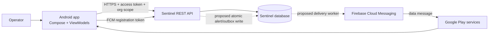

# Sentinel Mobile — Architecture and Implementation Specification

**Version:** 4.0 · **Status:** Implementation-ready design; backend dependencies require separate approval and implementation.  
**Target:** Native Android companion, Kotlin, Jetpack Compose.  
**Scope boundary:** This document specifies a client and the backend contract it needs. It does not authorize or perform source-code, database, or backend changes.

## 1. Purpose and scope

Sentinel Mobile gives an authenticated operator a focused way to receive and inspect high-priority security alerts while away from the desktop. Its in-scope features are:

- Sign-in, organization selection, session continuity, logout.
- Android device registration for push notifications.
- HIGH and CRITICAL push notifications, with privacy-safe content and alert deep links.
- Authenticated Alerts Queue, alert details, and recent security logs.
- Offline/error/loading states and refresh/recovery behavior.

The app does not run scans, change Sentinel configuration, perform incident response, administer users or tenants, reproduce the dashboard, or expose database operations.

## 2. Evidence and guarantees

The source architecture and connectivity documents are design inputs, not proof that proposed backend changes or end-to-end behavior exist. This specification retains the repository observations reported by the source architecture but marks them **source-reported, not independently re-audited here**. Before implementation, inspect the live API schemas, auth/session behavior, tenant authorization, runtime versions, and deployment topology.

The system cannot guarantee immediate or unconditional push display. FCM acceptance means Google accepted a send request; it does not prove delivery, display, sound, or user attention. Delivery and display depend on network, Google Play services, Android state, app permissions, notification channel settings, DND, OEM policy, and force-stop state. The laptop-hosted backend is unavailable while that machine is asleep, shut down, offline, or its worker is stopped. An Alerts Queue can recover only records the API exposes; bounded pagination without a cursor cannot guarantee complete recovery after a long outage.

Labels used below: **Reported** = described in source docs, unverified against current code; **Proposed** = required design; **Unknown** = must be established before implementation; **Platform limit** = cannot be promised by this app.

## 3. System architecture

Push is a notification/wakeup hint; the authenticated API and persisted alert record are authoritative. Push and API connectivity are independent paths. FCM does not require the phone to reach a laptop-hosted API; tapping a notification does.

### Android modules and responsibilities

| Module | Responsibility |
|---|---|
| `app` | Application composition, navigation, lifecycle, notification channels, permission UX. |
| `core/network` | HTTPS API client, auth interceptor, safe error mapping, bounded timeouts. |
| `core/auth` | Login, organization membership/selection, refresh serialization, logout. |
| `core/security` | Keystore-backed encryption key, encrypted credential persistence, redaction. |
| `core/data` | Repositories and DTO-to-domain mapping; never trust push payload as data authority. |
| `feature/alerts` | Queue, details, refresh, deduplication, empty/loading/error states. |
| `feature/logs` | Recent security log list, local filters, detail view. |
| `feature/registration` | FCM token sync, permission and registration status. |

Use unidirectional UI state: immutable screen state from ViewModels; user actions flow to repositories/use cases. Do not put tokens, API calls, or authorization decisions in composables. Keep local persistence minimal: selected organization ID, queue presentation cursor/last-seen marker if supported, and encrypted session material. No local alert cache is authoritative.

## 4. Authentication and session design

### 4.1 Client behavior

1. Sign-in over validated HTTPS with the existing Sentinel login contract. Never send credentials to a cleartext host in release builds.
2. Fetch memberships/organizations from the authenticated API and let the user select an authorized organization. Treat the selected ID as request context only; the server must authorize membership on every request.
3. Send access token as `Authorization: Bearer …` and selected scope using the server's confirmed organization header (the source docs call it `X-Organization-ID`). Do not infer tenant access from push payloads or local state.
4. On an expired access token, allow at most one coordinated refresh attempt for concurrent requests. Retry the original request once only after refresh succeeds. Do not recurse through the refresh interceptor.
5. Persist refresh retry identity only if the backend implements the documented idempotent refresh protocol. Generate a random request ID and reuse it only for retries of that same refresh operation; clear it only after a definitive response. Never invent a client-side grace window.
6. On logout, clear local credentials and best-effort revoke the session and device registration. A failed network revoke must not retain the UI session; server-side revocation still needs a reliable account/session lifecycle.

### 4.2 Security requirements and unresolved backend contract

The source design proposes short-lived access tokens plus rotating refresh tokens, replay detection, idempotent request-ID handling, revocation, and encrypted token storage. These are **not established as implemented**. Before shipping, define and verify exact request/response schemas, token lifetimes, rotation atomicity, idempotency-cache lifetime, concurrent refresh behavior, replay response, password-reset/session-revoke behavior, and migration/rollback plan. Do not claim refresh-token rotation is secure until adversarial concurrency and replay cases pass.

On Android, store secrets only in app-private storage encrypted with a key protected by Android Keystore. Prefer non-exportable keys; handle invalidated/lost keys by requiring sign-in again. Do not log tokens, passwords, FCM registration tokens, full push payloads, or sensitive alert fields. Exclude credential files from backup; set release backup/data-extraction rules explicitly and verify them on target Android versions. Biometrics may gate local app access but must not substitute for server authentication.

## 5. Device registration lifecycle

The Android app obtains an FCM registration token and sends it to an authenticated device-registration endpoint. The source documents propose `POST /mobile/devices/register`; endpoint existence and exact schema are **Unknown**. Required server properties:

- Bind token to authenticated user, installation/device record, and explicitly authorized organization memberships; never accept client-supplied user identity as authority.
- Upsert idempotently; protect against token rotation and simultaneous registration; avoid duplicate active records.
- Revalidate active user, session, membership, organization, device state, and alert eligibility immediately before dispatch.
- Deactivate on logout/session revoke, password reset policy, membership removal, user disablement, token invalidation, and explicit unregister. Define reauthorization after sign-in.
- Do not use IMEI, serial number, Android ID, or other hardware identifiers. Use an app-generated random installation identifier if a stable local handle is needed; treat it as untrusted and rotatable.
- Rate-limit registration, audit security-relevant changes, and avoid putting raw tokens in logs. Store tokens encrypted or access-controlled at rest.

Client handles FCM token rotation through `onNewToken` and retries sync when authenticated/connectivity returns. Token sync failure is visible as degraded push registration, not a failed login. Uninstall/reinstall, data clear, restore, and key loss require safe re-registration.

## 6. Alerts and logs API contract

The source documents report existing endpoints `GET /alerts/recent`, `GET /alerts/{alert_id}`, and `GET /logs/recent`; their deployed availability, pagination, fields, sorting, limits, and authorization are **not independently verified**. Confirm OpenAPI and test the real API before binding client DTOs. A safe minimal client expects stable IDs, ISO-8601 timestamps with timezone, severity enum, display-safe summary, and explicit pagination metadata. Unknown fields are ignored; unknown severity is rendered as neutral/unknown.

### Queue

- Load the most recent supported page for the selected organization on entry/foreground and on user refresh.
- Provide loading, empty, stale/offline, and retryable error states. Preserve last successful content with a clear “updated at” time; do not present stale content as live.
- Deduplicate by stable alert ID; sort using server order and timestamp only as a fallback.
- Queue items show severity, concise summary, source when safe, and timestamp. Treat all server strings as untrusted text; no HTML rendering or implicit links.
- Client-side severity/keyword filtering may operate on fetched items only and must not imply server-side completeness.
- Last-seen/read markers are per organization. They are presentation hints, not security acknowledgements or delivery receipts.

### Details

On tap, validate ID shape/length locally, then fetch details through the authenticated API. A push-provided organization ID is only a hint: compare it to the current authorized membership, require explicit organization switch if appropriate, and let the server reauthorize the requested alert. Never use the hint to grant scope. Show unavailable/deleted/forbidden as a safe generic state; avoid disclosing whether another tenant owns an ID.

### Security logs

Fetch only the supported recent window; paginate only using server-issued cursors. Show loading/error/empty states, local severity and keyword filters, and a detail sheet. Escape text, limit displayed field length, and redact credentials, cookies, authorization headers, and other secrets even if unexpectedly returned. Do not persist full logs for offline viewing unless separately threat-modeled and approved.

## 7. Push architecture and privacy

### 7.1 Backend prerequisites (proposed; not performed)

The source docs propose a transactional outbox and per-recipient delivery rows because the reported Sentinel backend has embedded workers and no message broker. Required semantics:

1. In the same database transaction as a qualifying HIGH/CRITICAL alert, write a durable outbox event. If the transaction fails, neither alert nor notification job is committed. Push failure must never roll back successful ingestion.
2. A worker claims rows with atomic compare-and-set/lease semantics supported by each actual database dialect. Verify SQLite and production database behavior under concurrent workers; do not rely on SQLite-only locking assumptions.
3. Select recipients server-side and revalidate authorization immediately before send. Scope to memberships permitted by product policy; no client-directed recipient list.
4. Use bounded retries with exponential backoff and jitter for retryable errors; distinguish invalid token, invalid credentials/configuration, quota/rate limit, permanent payload error, and transient network/server errors. Dead-lettering and retention must be observable and recoverable. Avoid silent loss.
5. Expire stale alerts under an explicit product rule and report them in queue/audit visibility; do not silently discard. Outbox retention and sensitive-data retention need documented limits.
6. Record FCM message ID as “accepted by FCM,” never “delivered.” Exactly-once push is not achievable across the send/DB-ack crash window; document at-least-once behavior and deduplicate best-effort on the client by alert ID.

No backend schema, worker, route, or Firebase configuration is changed by these documents. Confirm source-of-truth event transactions, deployment worker startup, DB dialect, and operational ownership before approving backend work.

### 7.2 FCM payload and Android presentation

Use FCM HTTP v1 (or Admin SDK backed by it) from a trusted backend only. Service-account credentials never enter the APK, mobile workspace, source control, logs, or client configuration. Prefer managed workload identity/ADC where available; if a key is unavoidable for local development, keep it outside synced folders and repositories with restricted access and a rotation/revocation procedure.

Send a data-only, minimal payload such as `{version, alert_id, severity, opaque_event_id}`. Do not include raw attack data, credentials, full logs, sensitive tenant details, internal URLs, or authoritative authorization claims. Validate size, types, version, ID, and severity on-device; reject malformed payloads. The app fetches details after the user taps.

Use HIGH priority only for genuinely time-sensitive qualifying alerts and respect platform quotas. Set a deliberate TTL and collapse policy; a collapse key may replace older pending notifications and therefore must never be used as the only record of an alert. Group related notifications to limit noise. Do not promise five-second delivery or sound. Android 13+ notification permission is runtime-controlled; create separate Critical/High channels with user-editable settings. Respect channel mute, DND, lock-screen privacy, and OS settings. Notification content stays minimal on lock screen. Tap uses an immutable, explicit PendingIntent, validates the alert ID, and routes through normal auth/scope checks.

### 7.3 Failure behavior

FCM token invalidation disables that token server-side. A device offline may receive a message later within TTL, or not at all. FCM may discard pending messages (including documented limits); handle `onDeletedMessages()` by fetching the supported alert queue. Force-stop can prevent app code from running until the user relaunches. Swiping away behavior varies by Android/OEM; do not equate it with force-stop. Channel settings and notification permission denial cannot be bypassed.

## 8. Mobile API connectivity

Connectivity to Sentinel REST API is independent of backend-to-FCM dispatch. Development options:

| Path | Use | Limits/security |
|---|---|---|
| Emulator `10.0.2.2` | Emulator to host loopback | Emulator-only; debug configuration; not a phone path. |
| USB `adb reverse` | Development phone over cable | Temporary, cable/ADB dependent; debug only. |
| LAN | Same-network testing | Requires reachable bind/firewall; expands local exposure; avoid cleartext credentials. |
| Private tailnet HTTPS proxy (e.g. Serve) | Remote real-device development | Tailnet membership required; laptop must remain available; verify TLS, access policy, proxy headers, and phone VPN interaction. Never enable a public Funnel for this design. |
| Hosted HTTPS | Production | Requires separately operated backend, DNS, certificates, secrets, monitoring, and threat review. |

Preferred development path is emulator/USB for local iteration and a private HTTPS tailnet path for remote real-device validation, subject to hands-on verification. Keep the backend bound to loopback when using a local reverse proxy. Do not assume Serve works, that a particular hostname passes host checks, or that Tailscale and FCM coexist reliably on the device; test them. If a VPN occupies Android's VPN slot, FCM behavior may change. Never disable certificate validation or ship a cleartext exception in release. Network reachability is not authorization.

## 9. Android reliability and UX

- `POST_NOTIFICATIONS` is requested in context after explaining value; denial leaves the Alerts Queue usable and explains how to enable notifications in system settings.
- Notification channels are created once with stable IDs; channel importance/sound cannot be silently changed after user control. Include an in-app channel status shortcut.
- API calls use finite connect/read/write timeouts, cancellation, bounded retries only for safe/idempotent requests, and jitter. Do not retry login or refresh indefinitely.
- Use network callbacks only as a refresh hint, not proof of internet/API reachability. Avoid aggressive polling; foreground entry and user refresh are primary queue sync triggers.
- Maintain access to last successful queue content in memory while the screen remains open, with stale label. Do not imply background execution or guaranteed sync.
- Accessibility: screen-reader labels, scalable text, contrast, touch targets, and non-color-only severity cues.

## 10. Security requirements

1. TLS certificate and hostname validation mandatory for non-loopback release endpoints; no permissive trust managers, debug CA trust, or release cleartext traffic.
2. Server authorizes every endpoint and every alert/log against current identity and tenant membership. Client tenant filtering is defense-in-depth only.
3. Minimize sensitive data in notifications, local storage, analytics, crash reporting, and logs. Redact authorization values and FCM tokens at all layers.
4. Use Android Keystore-backed encryption; exclude keys/secrets from backups; require fresh login when decryption key is unavailable.
5. Restrict exported Android components. FCM service is non-exported where platform/library configuration permits; deep links/PendingIntents are explicit and validated.
6. Apply server-side login, refresh, and device-registration rate limits; audit token and membership lifecycle events without storing secrets.
7. Do not claim the app fixes vulnerabilities in the existing backend. Security depends on verified server implementation, dependency updates, threat testing, and operational controls.

## 11. Implementation sequence and acceptance gates

**Gate 0 — Contract discovery:** obtain current OpenAPI, auth/session semantics, membership rules, database dialect/deployment facts, and confirmed private API route. Resolve all Unknowns in §13. No code should be written against guessed response schemas.

**Phase 1 — Android foundation:** create native Kotlin/Compose app, release/debug network policies, navigation, design system, and safe error/state model. Acceptance: release rejects cleartext and invalid certificates; no secrets in logs.

**Phase 2 — Auth and tenant context:** implement login, membership selection, coordinated refresh only against a verified contract, logout. Acceptance: unauthorized organization IDs fail server-side; replay/concurrent refresh tests pass if RTR is delivered.

**Phase 3 — Queue, details, logs:** implement API repository and screens. Acceptance: offline/stale/error/empty paths work; IDs cannot cross tenant boundaries; unsafe values render as text; pagination follows server contract.

**Phase 4 — Registration and push client:** permission UX, channel setup, token sync, data-message validation, tap routing. Acceptance: token rotation, denial, logout, reinstall, invalid payload, and auth-expired tap are handled.

**Phase 5 — Backend push prerequisites:** only after separate backend approval, implement the approved registration and outbox contract in the Sentinel repo. Acceptance: atomic outbox, concurrent claim safety on production DB, recipient reauthorization, bounded retry/error taxonomy, invalid-token deactivation, audit/metrics, and no ingestion blocking.

**Phase 6 — End-to-end validation:** verify emulator, USB, private HTTPS real phone, offline laptop, offline phone, Doze, permission denial, force-stop, DND/channel mute, alert storms, FCM token invalidation, tenant isolation, and duplicate send crash windows. Record observed limits; no timing guarantee is inferred from a successful single run.

## 12. Test and acceptance matrix

| Area | Minimum cases |
|---|---|
| Auth | Invalid credentials; expired access; refresh timeout/retry; concurrent refresh; replay; revoked session; logout offline. |
| Tenant | Missing/forged organization header; membership removed; foreign alert ID; push with forged org hint. Expect no cross-tenant data. |
| Push | HIGH/CRITICAL; ignore MEDIUM/LOW; malformed/oversized payload; duplicate alert ID; stale TTL; invalid FCM token; FCM accepted but no display. |
| Android | Permission grant/deny; channel muted; DND; lock screen; Doze; app swiped away; force-stop; no Play services; token rotation. |
| Network | TLS hostname failure; captive/no network; laptop asleep; private proxy down; app VPN interaction; retry without credential loss. |
| Privacy | Inspect logs, backups, crash reports, local files, notification previews for tokens/secrets/raw sensitive content. |
| Outbox (backend gate) | Atomic transaction rollback; competing workers; lease expiry; process crash before/after send; retry classification; storm control. |

## 13. Assumptions and decision register

| ID | Question/decision | Current status and required resolution |
|---|---|---|
| A1 | Are the named API routes and exact DTOs deployed? | Unknown; inspect live OpenAPI and integration environment. |
| A2 | Is refresh-token rotation already supported? | Source proposes it; unknown; verify code/schema before client design. |
| A3 | Does device registration endpoint/model exist? | Proposed only; requires approved backend work if absent. |
| A4 | Does alert create and outbox insert share one transaction? | Proposed; verify event paths and all alert creation sources. |
| A5 | Which production DB dialect and worker topology are used? | Unknown; concurrency design depends on it. |
| A6 | What are alert pagination, retention, and maximum queue window? | Unknown; drives missed-alert recovery completeness. |
| A7 | What retry, TTL, stale alert, and storm-suppression policy is acceptable? | Product/operations decision required; do not silently drop alerts. |
| A8 | Does private HTTPS proxy work on this Windows host and phone? | Untested; verify from inside/outside tailnet and mobile data. |
| A9 | Does phone VPN affect FCM in target setup? | Untested; verify with actual device and network. |
| A10 | Which Android min/target SDK and dependency versions? | Resolve against current build/Play requirements at implementation. |
| A11 | Is notification sound appropriate and user-controlled? | User channel control and DND always take precedence. |
| A12 | Who owns Firebase project, least-privilege identity, keys, and rotation? | Assign before enabling dispatch. |

## 14. Delivery definition

The implementation is ready for production consideration only when Android acceptance gates and any separately approved backend gates pass on the real deployment database and a representative Android device. A design document cannot verify those outcomes. Record test evidence, unresolved risks, operational alerting/ownership, and rollback steps before release.

---
*End of architecture specification.*
