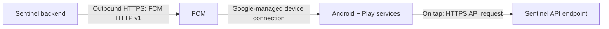
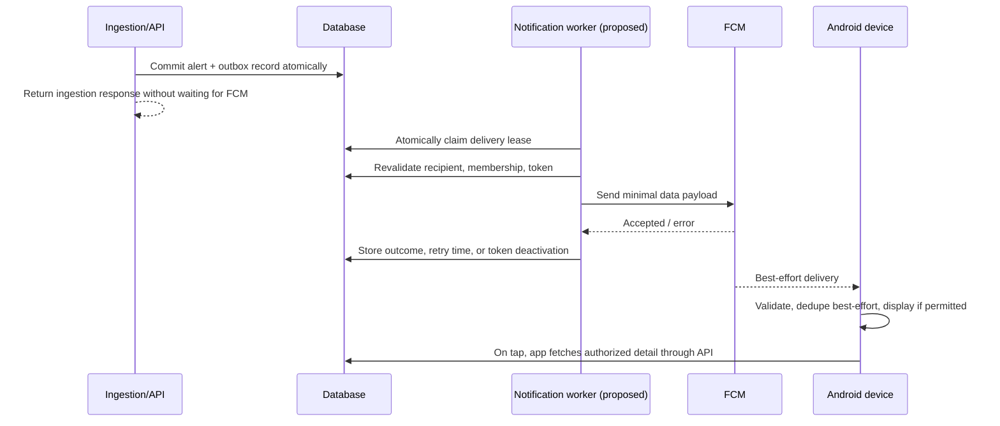

# Sentinel Mobile — Connectivity and Push Delivery Design

**Version:** 4.0 · **Status:** Implementation-ready connectivity design; environment-specific behavior remains to be verified.  
**Companion document:** `SENTINEL_MOBILE_ARCHITECTURE_IMPLEMENTATION.md`  
**Scope:** Android companion API connectivity, FCM push path, development networking, and failure recovery. No backend/source-code changes are made or authorized here.

## 1. Purpose and boundary

This document resolves the key networking distinction: sending an FCM message and making the Android app reach the Sentinel API are separate connections with separate failure modes.

The backend can submit a push while a phone has no API route to a laptop. The push can prompt the app to display a minimal notification, but fetching the alert details requires API connectivity and valid authentication. A laptop-hosted backend cannot serve the phone while the laptop is asleep, shut down, offline, or its API/proxy is stopped.

**Never guaranteed:** a notification arriving within a fixed number of seconds, display while the app is force-stopped, sound despite user settings/DND, or recovery of alerts beyond the API's available result window. FCM send acceptance is not device delivery or user acknowledgement.

## 2. Evidence labels and source inputs

- **Reported:** source architecture document describes FastAPI/REST, SQLAlchemy, existing alert/log routes, and embedded database-claiming workers; not independently re-audited for this revision.
- **Proposed:** target design that requires backend implementation or contract verification.
- **Untested:** environment-specific operation not demonstrated on the current laptop/phone.
- **Unknown:** must be resolved before implementation.

The connectivity input proposed an outbox, device registration, a private tailnet HTTPS route, and a Firebase sender identity. These are recommendations, not claims of deployed functionality. Do not infer a Firebase project, device table, registration API, worker, TLS hostname policy, or deployment topology exists.

## 3. Two independent communication paths

### Path A — Backend to FCM to device

1. Backend recognizes a qualifying HIGH/CRITICAL alert.
2. **Proposed:** same database transaction writes alert plus durable outbox work.
3. **Proposed:** background worker selects authorized active device tokens and rechecks current user/session/organization membership.
4. Backend sends a minimal data message to FCM over outbound HTTPS using a server identity.
5. FCM may queue/send to Google Play services, subject to its own policy, TTL, device reachability and limits.
6. Android app validates the message and displays a local notification only if OS permission/channel settings allow it.

An FCM HTTP success and returned message identifier mean only “accepted by FCM.” They do not prove the phone received, processed, displayed, sounded, or was seen by a person.

### Path B — Device to Sentinel API

The app connects to the configured API base URL using validated TLS (except isolated debug loopback paths). Each request carries the confirmed bearer access token and the server's organization-scope header. Organization scope is untrusted input; the API must authorize every request against current memberships. Push payloads and private-network membership never confer API authorization.

## 4. API reachability options

| Method | Appropriate use | Requirements and caveats |
|---|---|---|
| Android emulator `10.0.2.2` | Emulator accessing host loopback service | Emulator-specific alias; not usable from a physical phone. Debug profile only. |
| USB `adb reverse` | Physical test phone at developer desk | USB/ADB connection and command lifecycle; not remote; debug only. |
| Same Wi-Fi LAN | Quick local-device testing | Backend must listen on reachable interface and firewall allow it; increases network exposure. Prefer TLS; never expose auth tokens over cleartext. |
| Tailnet-only HTTPS proxy (candidate: Tailscale Serve) | Remote development phone | Both devices in authorized tailnet; laptop awake; proxy, DNS, certificate, host-header, and access policy validated. Never use public Funnel or public port forwarding for this local plan. |
| Hosted HTTPS backend | Production/always-available operation | Independently deployed and operated backend, stable DNS/TLS, secrets, monitoring, and threat review. |

Recommended development arrangement: use emulator alias for emulator work, USB reverse for desk-based phone work, and validate a tailnet-only HTTPS proxy for remote real-device testing. Do not use a plain LAN or public tunnel as an undocumented substitute. Keep a local backend on loopback if the chosen proxy forwards to loopback. Avoid disabling TLS validation or adding a release cleartext exception to make a path work.

### Tailnet proxy verification checklist

Before using the path, verify with the actual Windows host and Android device:

1. Confirm the backend's real bind address and port; confirm proxy target is loopback and no public listener was created.
2. Confirm the phone resolves the intended private hostname only in the expected tailnet and presents a valid certificate for that hostname.
3. Confirm a device outside the tailnet cannot reach the API endpoint.
4. Confirm Host header/trusted-host policy, reverse-proxy forwarding headers, rate-limit client IP interpretation, and CORS if browser clients are also involved. Native Android does not rely on browser CORS, but server host validation still applies.
5. Verify from mobile data with the phone's actual VPN configuration. Android generally has one active VPN slot; a tailnet VPN can interact with another VPN and may affect FCM. Test, do not assume.
6. Record laptop sleep, proxy restart, and internet interruption behavior. A proxy path is not an always-on production service.

## 5. FCM sender and credential design

Use FCM HTTP v1 through a maintained Admin SDK or equivalent supported sender. Authentication is server-side OAuth/service identity. The Android app may contain normal Firebase client configuration and its FCM token, but never a Firebase service-account private key or sender credential.

Credential order of preference:

1. Production: workload identity/application default credentials with least privilege where supported by deployment.
2. Local development if unavoidable: dedicated sender identity with minimum FCM send permissions; key stored outside Git, mobile project, OneDrive/synced folders, and distributable artifacts, with restrictive filesystem permissions and a rotation/revocation process.

Do not paste keys into Markdown, chat logs, environment reports, Android resources, CI output, or source control. Redact secrets from errors. Define credential owner, access review, expiry/rotation, compromise response, and sender project/app identity before enabling sending. Exact IAM role names and network allowlists depend on current Google product configuration and are not verified here.

Outbound connectivity requirements and Google hostnames must be checked against current vendor documentation and the actual firewall/proxy. Do not open inbound laptop ports for FCM. Device-side FCM delivery uses Google-managed connectivity and can vary by OS/device/network; this plan does not claim a fixed port path will work on every VPN or carrier.

## 6. Proposed durable send flow

The source architecture reports no external broker and describes embedded workers. The connectivity input proposes extending a relational outbox pattern; this must be validated against actual code and production DB before implementation.

Required backend properties if approved:

- Alert and outbox entry are committed together, so a database rollback creates neither; FCM failure never blocks or rolls back telemetry ingestion.
- Delivery attempts are persisted per recipient/device with state, bounded attempt count, next-attempt time, lease owner/expiry, safe error category, and timestamps. Never persist service credentials in job rows.
- Atomic claim/lease semantics are selected for the real DB dialect; prove competing workers cannot double-claim under its isolation/locking semantics. Test process crash before send, after FCM accepts, and before outcome commit.
- Recipient selection happens server-side from current authorization records. Revalidate immediately before each attempt; reject revoked session, disabled account, removed membership, inactive device, and stale token.
- Retry transient network/server/temporary quota responses with bounded exponential backoff and jitter. Invalid/unregistered token deactivates that token. Permanent configuration/auth/payload errors alert operators and must not retry forever. Honor provider retry guidance and quotas.
- Establish operational dashboards/alerts for oldest pending age, attempts, failure categories, worker heartbeat, dead-letter count, and token churn. Protect metrics from exposing tokens or alert contents.
- Define retention, stale-alert policy, storm suppression, and manual redrive. Never silently drop a row due only to local laptop outage or worker timeout.
- Delivery is at-least-once in the send/ack crash window. Exactly-once notification delivery cannot be promised. Use stable alert ID for client-side duplicate suppression; client dedupe is best-effort because app storage can be cleared.

## 7. Payload, TTL, priority, and user-visible notification

Use a data-only, compact payload with version, stable alert ID, severity, and opaque event identifier at most. Do not include raw attack vectors, credentials, full logs, internal addresses, or unnecessary organization names. The push is untrusted input and not the record of authority.

The client validates known schema version, size, ID, and severity; rejects malformed messages; and fetches details after tap. Use explicit immutable PendingIntents and an allowlisted in-app route. The organization identifier, if sent at all, is only a hint and must be checked against server-authorized memberships.

Choose TTL and collapse behavior as explicit product decisions. A short TTL reduces stale pages but increases missed notifications after outages; a long TTL can surface old threats late. A collapse key may replace older pending messages, so it is acceptable only because the Alerts Queue is the record of alerts. Alert-storm bundling should say there are additional alerts and direct the user to the queue; it must not imply all pushes were individually shown.

Use high-priority FCM only for time-sensitive qualifying alerts, subject to quotas and provider policy. Android 13+ notification permission is user-controlled. Critical and High channels may have distinct defaults, but users can change or mute them; channel settings cannot be overridden by the app. DND, lock-screen privacy, battery policy, OEM restrictions, sound/vibration, and notification ranking remain OS/user controlled. Request permission contextually and keep queue access available after denial.

## 8. API sync and missed-alert recovery

The queue is the recovery mechanism, independent of push delivery:

- Fetch on successful login/organization selection, Alerts screen entry, foreground return, explicit pull-to-refresh, and an `onDeletedMessages()` callback.
- A network-available callback may trigger one debounced refresh; it does not prove the API works.
- Keep the last successful in-memory result visible with “last updated” and stale/error state. Do not fabricate unread totals from incomplete pages.
- Track last-seen per organization only as a UI convenience. Use a server cursor/watermark if the API supports it.
- If the endpoint returns only a bounded recent window and lacks a `since` filter/cursor, recovery is limited to that window. The client cannot guarantee completeness after a long outage or alert storm. Adding pagination/watermark support is a backend contract change and needs separate authorization.
- A notification tap while API is unreachable displays a safe minimal summary from validated payload and a retry action; fetch canonical detail when reachable. Never represent the payload as full forensic data.

## 9. Failure modes and intended response

| Failure | User/system effect | Required response / limit |
|---|---|---|
| Laptop asleep/offline | API and local worker unavailable; pending sends wait in DB only if DB survives | Show stale/offline state on API request; resume durable work on recovery. No availability guarantee. |
| Backend or proxy stopped | Phone cannot fetch queue/details | Retry on user action/foreground with bounded backoff; preserve local auth unless server definitively revokes it. |
| Phone offline | API unavailable; push may be queued or discarded/expire | Refresh queue after reconnect; missed alerts limited by endpoint window. |
| FCM transient error | Delayed or absent push | Retry from durable outbox; alert on growing backlog. |
| FCM accepts but app never displays | No visible notification | Do not mark delivered; queue remains authoritative; acceptance is not device receipt. |
| Invalid FCM token | Repeated send failure | Deactivate token and request refresh/re-registration on next app launch. |
| Android permission denied/channel muted/DND | No visible or audible notification | Explain settings and retain queue access; cannot bypass user choice. |
| Force-stop | App background processing/receive unavailable until launch | No workaround; server retains record if configured; user must relaunch. |
| App swiped away | OEM/Android behavior varies | Test target devices; do not equate with force-stop or guarantee delivery. |
| Tailnet unavailable/wrong VPN | API path broken; possible FCM interaction | Clear connection error and fallback path; test with actual VPN configuration. |
| More pending FCM messages than provider retains | Provider can discard pending messages | Handle deletion signal if delivered and perform full supported queue refresh. |
| Alert storm | Throttling/collapse may reduce individual pages | Persist alerts, bundle with honest wording, expose queue window/lag. |
| Duplicate send after worker crash | Duplicate notification possible | Stable alert ID and best-effort client dedupe; at-least-once only. |

## 10. Network and data protection

- Release uses HTTPS with platform hostname/certificate checks. Never accept all certificates, ignore hostname mismatch, or ship a debug trust anchor/cleartext exception.
- Debug loopback/USB-only cleartext allowances, if required, are restricted to debug manifest/network security config and excluded from release artifact; verify the built release configuration.
- Backend must not be made public merely to reach a phone. Tailnet membership is an additional network gate, not authentication. API auth and tenant authorization remain mandatory.
- Review backend trusted-host settings, reverse proxy headers, client IP/rate limiting, CORS where relevant, and forwarded-proto handling before proxy deployment.
- Do not place passwords, bearer/refresh tokens, FCM tokens, or service-account keys in URLs. Redact them from client/server/proxy logs, crash reports, analytics, and support bundles.
- The app stores only encrypted session data and minimal queue state in app-private storage. Exclude secrets from device backup. Key loss requires sign-in; never fall back to plaintext.

## 11. Connectivity and push validation plan

All checks below are future acceptance work; none is claimed complete by this document.

### A. Baseline discovery

- Obtain current API schema and verify auth, organization selection, alert queue/detail, logs, registration, refresh, and error responses.
- Establish backend bind/launch settings, actual DB dialect, worker process topology, host/trusted-host/CORS policy, reverse-proxy trust behavior, and collector buffering characteristics.
- Identify an Android device/OS/OEM, Google Play services availability, notification permission state, and VPN setup.
- Identify Firebase project/app ownership, credential model, outbound firewall policy, quotas, and monitoring owner.

### B. API transport

- Emulator: call an approved non-sensitive health endpoint via `10.0.2.2` using debug configuration.
- USB: validate `adb reverse` from a physical device and confirm teardown/reconnect behavior.
- Private HTTPS: test DNS/certificate/host policy, API auth, tenant authorization, mobile data access, tailnet nonmember denial, and laptop sleep/proxy failure.
- Verify invalid certificate and wrong hostname fail closed in release build. Confirm no public inbound listener or Funnel.

### C. FCM path

- In a dedicated test Firebase project/device, register token and send one HIGH test data message from a trusted sender. Confirm server credentials are absent from APK and client repo.
- Test foreground, background, Doze, permission denial, channel muted, DND, Wi-Fi vs mobile data, app swipe, force-stop, and phone reboot as applicable.
- Repeat with the actual VPN setup and record any FCM/API interaction. Do not infer reliability from one success.
- Verify invalid token handling, transient sender outage, stale TTL, duplicate send crash window, and alert storm behavior against a durable test outbox.

### D. End-to-end and tenant tests

- Generate a test alert through the normal authorized path; confirm alert persistence is independent of FCM; dispatch and record accepted status; tap and fetch detail via API.
- Alter organization hint and alert ID; remove membership/session; verify no data leaks.
- Take laptop offline and phone offline separately; restore and verify bounded recovery semantics, duplicate handling, and stale labels.
- Test > provider pending-message limit or simulated `onDeletedMessages()` path and verify queue resync only covers documented API pagination.
- Inspect app/backend/proxy logs and backups for secrets and prohibited payload content.

## 12. Decisions and unresolved facts

| ID | Topic | Default design | Status / resolution |
|---|---|---|---|
| C1 | Push transport | Outbound server to FCM HTTP v1; no inbound push port | Proposed; confirm Firebase ownership and credentials. |
| C2 | Device enrollment | Authenticated idempotent registration; server-owned identity/memberships | Route/schema unknown; backend approval if absent. |
| C3 | Outbox | Transactional alert/outbox with durable per-recipient state | Proposed; verify transaction boundaries and real DB locking. |
| C4 | Retry horizon | Bounded backoff plus operationally visible pending/dead-letter state | Exact schedule/open; operations/product decision. |
| C5 | TTL/staleness | Explicitly chosen, no silent stale-send/drop | Open; product must weigh late page vs missed page. |
| C6 | Storm controls | Group/bundle and rate-limit presentation, preserve alert records | Thresholds and suppression policy open. |
| C7 | API recovery | Foreground/queue refresh and deletion-signal resync | Depends on endpoint pagination and retention, unknown. |
| C8 | Worker health | Lag, heartbeat, failure-category and dead-letter alerts | Required operational design; implementation unknown. |
| C9 | Development network | Emulator/USB locally; candidate tailnet HTTPS for phone away from desk | Untested on this host/device; verify before adoption. |
| C10 | Funnel/public tunnel | Prohibited for laptop-hosted development backend | Constraint for this design. |
| C11 | Phone VPN and FCM | Test actual device configuration | Unknown; do not promise compatibility. |
| C12 | Production availability | Hosted managed HTTPS service if always-on access is required | Deferred; laptop hosting cannot meet always-on availability. |
| C13 | Push evidence wording | “Accepted by FCM” only | Required; never claim delivery/read based on send response. |

## 13. Go/no-go criteria

Do not enable real recipient push until the device-registration authorization model, tenant isolation, alert/outbox atomicity, production-DB claim semantics, secret handling, retry/staleness policy, monitoring, and token deactivation lifecycle are implemented and validated. Do not ship API access until TLS, current API schemas, session semantics, release network policy, and cross-tenant denial are verified. If these backend prerequisites are absent, the Android client design can proceed against a mock/test contract, but production push cannot be considered complete.

---
*End of connectivity and push design.*
